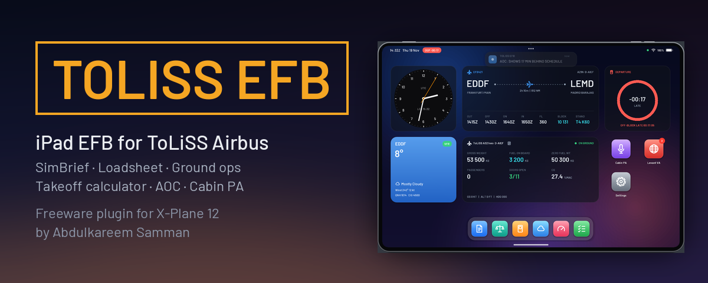
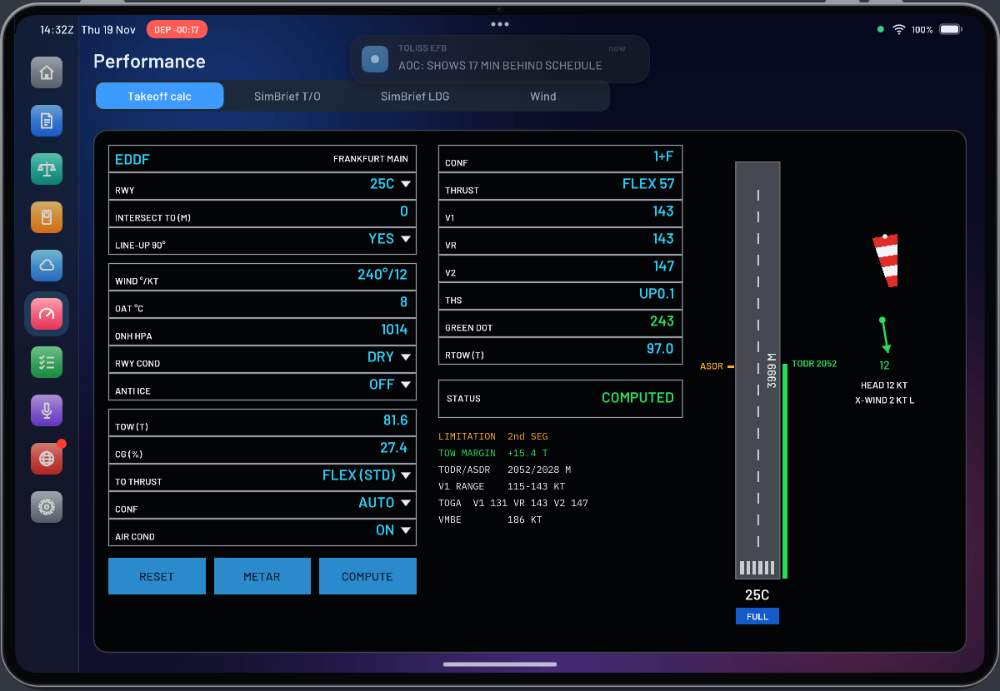

# ToLiSS EFB

**Made by Abdulkareem Samman** · © 2026 Abdulkareem Samman

**[⬇ Download the latest version](https://github.com/abdulkareem140/toliss-efb-releases/releases/latest)** ·
[What's new](CHANGELOG.md) · [Report a bug](https://github.com/abdulkareem140/toliss-efb-releases/issues/new/choose)

This repository holds the downloads, the SkunkCrafts Updater files and the bug reports for ToLiSS EFB.

A modern tablet-style EFB plugin for **X-Plane 12** and the **ToLiSS Airbus** family
(A319, A320ceo/neo, A321/neo, A330-900, A340-600). It looks and works like a real iPad:
aluminium frame, rounded screen, iPadOS status bar, Home Screen widgets, app icons and a dock.
Everything is drawn in code and nothing is copied from any other product.

| Loadsheet (boarding in progress) | Ground Ops |
|---|---|
|  |  |
| **Takeoff calculator** | **Custom wallpaper** |
|  |  |

## Apps

| App | What it does |
|---|---|
| **Home** | An iPadOS Home Screen. Widgets: analog UTC clock, today's flight (route, OUT/OFF/ON/IN, block fuel, arrival stand), departure countdown ring, weather and live aircraft weights, pax, doors and CG. Tap a widget to open its app. App icons sit beside the widgets, and the dock at the bottom holds your favourite apps plus the ones you used last. |
| **Flight Plan** | Fetches your latest **SimBrief** OFP. Has Summary, Navlog, Fuel breakdown (stacked bar), Weights vs. limits and the full OFP text. The OFP is cached, so it's still there after a restart. |
| **Loadsheet** | Plan pax, forward and aft cargo and block fuel (from the OFP or by hand). Loads the aircraft **instantly** or **realistically**: boarding, cargo and refuelling run over time with progress bars, pause and stop. Shows planned vs. actual ZFW/TOW/LW against MZFW/MTOW/MLW, and prints a final loadsheet. |
| **Ground Ops** | Top-down aircraft diagram: tap a door to open or close it. Doors follow the aircraft's real door position, so a door opened from the ToLiSS ISCS shows as open, and doors swing on the diagram while moving. **Ground Power, Wheel Chocks, HP Air and LP Air** are found automatically on your aircraft. The **ToLiSS vehicles** tab drives the aircraft's own passenger stairs (1L, 2L), catering trucks (1R, 2R) and baggage loaders. **Customize** chooses which services are shown and which dataref each one uses. |
| **Weather** | METAR and TAF from aviationweather.gov, with quick chips for origin, destination, alternate and nearest. Decodes wind, visibility, ceiling, temperature and QNH, and shows a flight-category badge. |
| **Performance** | **Takeoff calculator** in the style of the airline tools (see below), plus the SimBrief takeoff/landing reports and a wind-component calculator. |
| **Checklists** | Tap-through normal checklists by phase, with progress and a "next item" highlight. |
| **Airline** | AOC messages with your airline (see below) and the **Levant VA** website (https://levant-va.com/), opened in your web browser. The name and address can be changed. |
| **Settings** | SimBrief ID, kg/lb, passenger weight, cargo split, boarding/cargo/refuel rates, night/day theme, accent colour, **iPad finish** (Space Grey, Silver, Starlight, Blue), brightness and window behaviour. **Background:** gradient presets, three bundled wallpapers or **your own picture**. Press *Upload picture...* to open your computer's file picker, or paste a link to a JPG/PNG. Uploads are kept in `Output/preferences/toliss_efb_wallpapers`, so plugin updates don't delete them. There's also a dim slider. **Cockpit:** calibration of the 3D tablet. **Diagnostics:** dataref mapping (green = found, red = missing) and a live **Explorer** of every dataref. |

The window can sit inside the sim (drag it by the bezel, resize it from the edges),
**pop out** to its own OS window for a second monitor, or follow you into **VR**. The **•••** button
at the top of the screen opens the window menu (open in own window / return to the sim, hide),
just like iPadOS multitasking. It can
also go **onto the ToLiSS tablet in the 3D cockpit** (see below).

## What's new

See [CHANGELOG.md](CHANGELOG.md) for every version.

## On the 3D cockpit tablet

The EFB can replace the picture on the aircraft's own cockpit tablet. It draws into the
aircraft's panel texture, over the screen you calibrate, and you use it by clicking on the
3D tablet as usual.

1. Sit in the 3D cockpit, looking at the tablet so its whole screen is visible.
2. **Plugins → ToLiSS EFB → Auto-calibrate cockpit tablet...** (or *Settings → Cockpit → Auto calibrate*).
3. **Press and hold** the mouse on the tablet's screen and scribble back and forth **past all four
   edges**, then let go. The plugin fits the screen's position and rotation from that one gesture.
4. If the edges are a little off, nudge them in *Settings → Cockpit → Fine tune*. If auto
   calibration doesn't find the screen, the menu also has a manual mode: click the top-left
   corner, then the bottom-right one.

Calibration is saved per aircraft type (A319, A20N, A321, ...). **Plugins → ToLiSS EFB → Show on
cockpit tablet**, or the command `toliss_efb/cockpit_toggle`, switches between our EFB and the
original ToLiSS one. The × in the status bar does the same.

How it works: X-Plane tells plugins where the mouse ray hits the panel texture
(`sim/graphics/view/click_3d_x_pixels` / `_y_pixels`). A transparent, full-screen capture window
takes clicks that land on the calibrated screen and **passes every other click, and all
right-clicks (mouse look), straight back to the cockpit**.

Limitations:
* This only works if ToLiSS draws its tablet into the panel texture, which is how ToLiSS draws
  its cockpit screens. If nothing appears after calibrating, it doesn't, and the floating window
  is the way to go.
* The cockpit screen has only a few hundred texture pixels, so small print is soft. Headline
  values stay readable; zoom in (or use the floating window) for the fine print.
* In VR, the 3D-click datarefs don't follow the controllers, so use the floating window there.

## Install

**Easiest: SkunkCrafts Updater** (free, on the X-Plane.org forums). Install the plugin once
from the latest release zip (below). It contains `skunkcrafts_updater.cfg`, so SkunkCrafts Updater finds it in
`Resources/plugins/ToLiSS_EFB` and keeps it up to date. The tablet also tells you (Settings > About, and a badge on
the Settings icon) when a new version is waiting. Your settings, recordings, wallpapers and calibrations live in
`Output/preferences`, so updates never touch them.

Manual install:

1. Download the latest `ToLiSS_EFB_vX.Y.Z.zip` from the [**Releases** page](https://github.com/abdulkareem140/toliss-efb-releases/releases/latest) and unzip it into `X-Plane 12/Resources/plugins/`, so you get
   `Resources/plugins/ToLiSS_EFB/64/win.xpl` (Windows) or `lin.xpl` (Linux) plus the `resources/` folder.
2. Start X-Plane and load a ToLiSS aircraft.
3. Open it with **Plugins → ToLiSS EFB → Show / hide tablet**, or bind a key or joystick
   button to the command **`toliss_efb/toggle`** (`toliss_efb/popout` pops it out).
4. In **Settings**, enter your SimBrief username or numeric pilot ID and press *Fetch latest OFP*.

## Takeoff calculator

The real tool Airbus pilots use (FlySmart with Airbus / PEP) runs on Airbus's certified
performance database, which is licensed to airlines and not publicly available. This calculator
uses the same inputs and gives the same outputs, but computes them with a physics model:

* **Inputs:** airport and runway from **X-Plane's own airport database** (`apt.dat`: real lengths
  and true headings), dry/wet, wind, OAT, QNH (one tap fills these from the METAR), takeoff weight
  (from the aircraft or the plan), CG, flaps (OPT / 1+F / 2 / 3), FLEX/TOGA, anti-ice, packs and slope.
* **Model:** integrates the ground run (thrust lapse with speed and temperature, aerodynamic drag,
  rolling friction, slope) for all engines and one engine out. From that it gets the takeoff
  distance (×1.15 for all engines; 35 ft screen, 15 ft wet), accelerate-stop with 2 s at V1, the
  balanced V1 and the one-engine-out second-segment climb (2.4 % twin / 3.0 % quad). Wind is
  factored 50 % headwind / 150 % tailwind. V2 = 1.13 VS1g, with VMCG/VMCA limits.
* **Outputs:** the highest legal **FLEX** (max 25 % thrust reduction), V1/VR/V2, THS for the CG,
  required vs. available distances, wind components, what limits the result, and **OPT CONF**, which
  picks the flap setting that allows the most FLEX. If no takeoff is legal, it says why and gives
  the maximum TOW.

Results land close to typical published numbers, but they are **estimates, not certified data**.
Always compare them with the ToLiSS MCDU PERF TAKE OFF page.

## ⚠️ First flight: verify the datarefs

The tablet talks to the aircraft only through the names in
`ToLiSS_EFB/resources/datarefs.ini`:

* **Loading** uses `AirbusFBW/NoPax`, `PaxDistrib`, `FwdCargo`, `AftCargo`, `WriteFOB`
  and the command `AirbusFBW/SetWeightAndCG`. These are the names community SimBrief-loader
  scripts use for ToLiSS.
* **Doors** use `AirbusFBW/PaxDoorModeArray[i]` / `CargoDoorModeArray[i]`
  (0 = closed, 2 = open). **The index order differs between types.** Check it.
* **Ground services** (GPU, chocks, HP/LP air) and **door positions** are **found automatically**.
  X-Plane 12 lets plugins list every dataref, and the plugin ranks ToLiSS's by name, preferring
  writable values over cockpit buttons, lights and animations. *Ground Ops → Customize* shows the
  choice for each service and lets you pick another. *Settings → Diagnostics → Explorer* shows
  every dataref live: toggle something in the aircraft and watch which value changes.

Open **Settings → Diagnostics** with the aircraft loaded. Red rows don't exist in your
aircraft. Fix them in the INI and press *Reload*. No recompiling is needed. You can add
per-type sections such as `[doors.A21N]` or `[limits.A339]`.

## What this is and isn't

* Weights shown as "planned" are estimates. The "aircraft" column is what X-Plane reports.
  Always cross-check V-speeds and FLEX against the MCDU PERF pages.
* Checklists are simplified and for simulation only.
* Not affiliated with ToLiSS, Fenix Simulations, SimBrief/Navigraph or Laminar Research.

## Report a bug

On the tablet: **Settings > About > Report a bug...** It opens a pre-filled issue here, with the version, X-Plane,
aircraft and the plugin's recent log (your folder names removed). You can also
[open an issue](https://github.com/abdulkareem140/toliss-efb-releases/issues/new/choose) yourself.

## Licences

ToLiSS EFB: © 2026 Abdulkareem Samman (see `LICENSE`). It includes Dear ImGui (MIT), nlohmann/json (MIT), and the
Barlow and IBM Plex Mono fonts (SIL Open Font License 1.1).
