# ToLiSS EFB

**Made by Abdulkareem Samman** · © 2026 Abdulkareem Samman

**[⬇ Download the latest version](https://github.com/abdulkareem140/toliss-efb-releases/releases/latest)** ·
[What's new](CHANGELOG.md) · [Report a bug](https://github.com/abdulkareem140/toliss-efb-releases/issues/new/choose)

This repository holds the downloads, the SkunkCrafts Updater files and the bug reports for ToLiSS EFB.

A modern tablet-style EFB plugin for **X-Plane 12** and the **ToLiSS Airbus** family
(A319, A320ceo/neo, A321/neo, A330-900, A340-600). It looks and works like a real iPad:
aluminium frame, rounded screen, iPadOS status bar, Home Screen widgets, app icons and a dock.
Everything is drawn in code and nothing is copied from any other product.

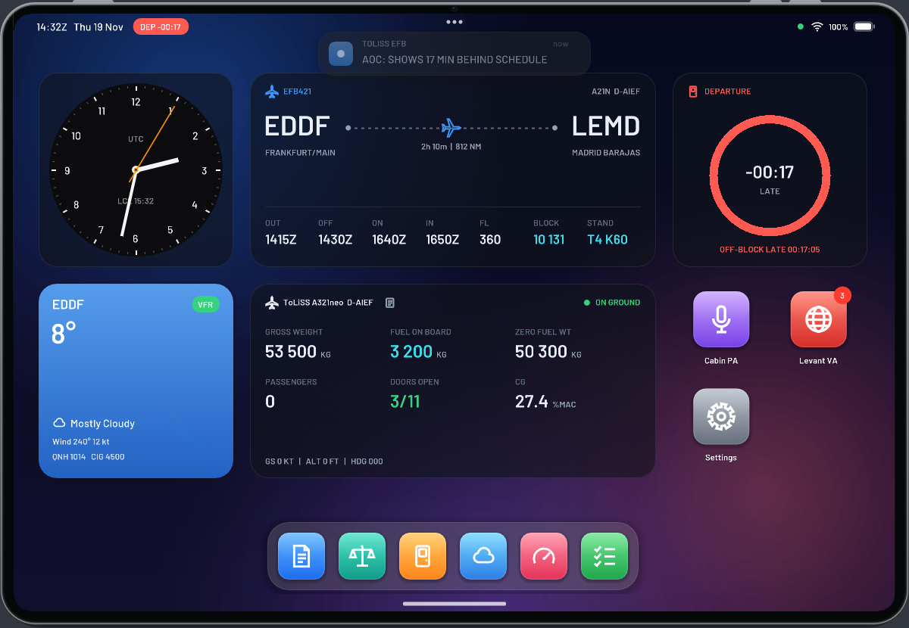

| Loadsheet (boarding in progress) | Ground Ops |
|---|---|
| 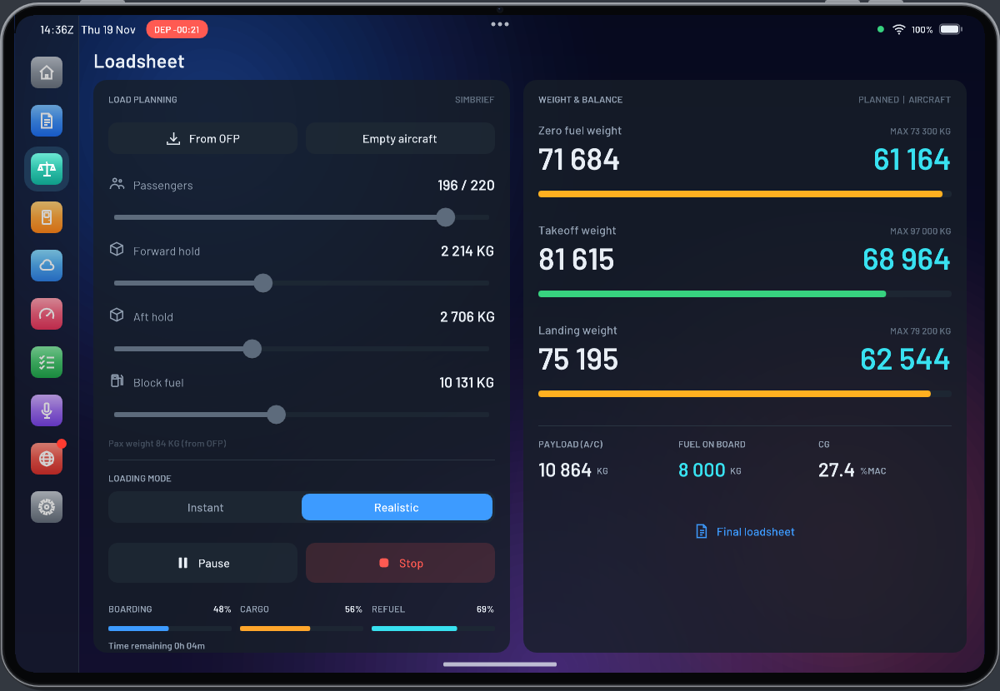 | 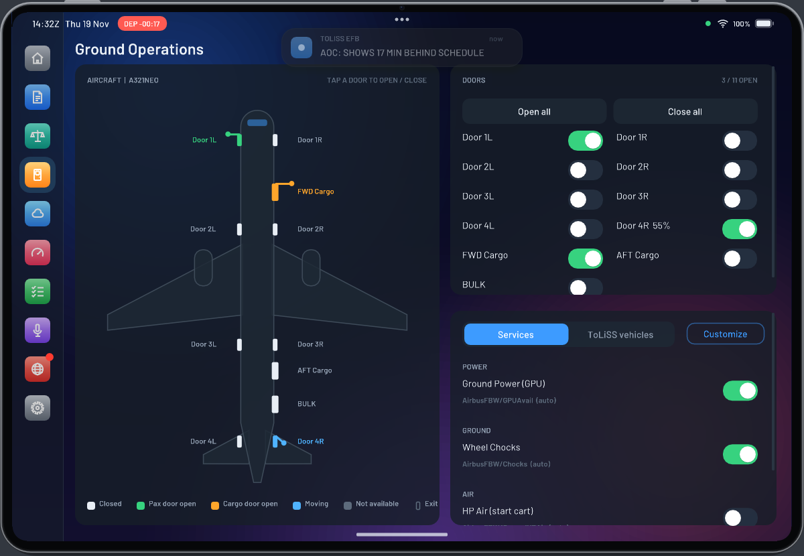 |
| **Takeoff calculator** | **Custom wallpaper** |
|  | 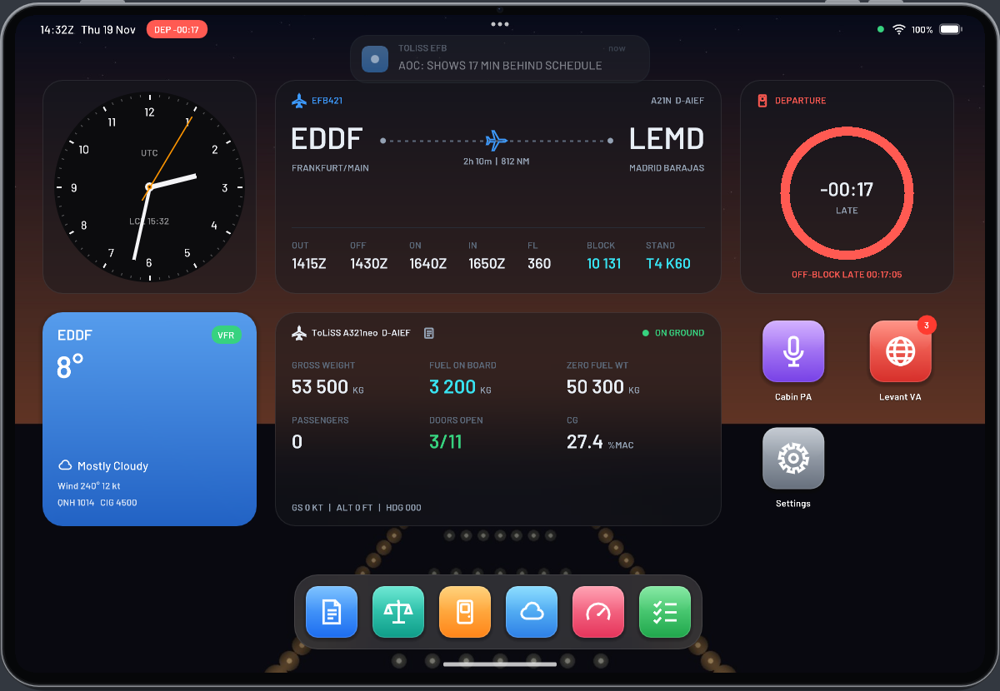 |
| **Landing calculator** | **Map** |
| 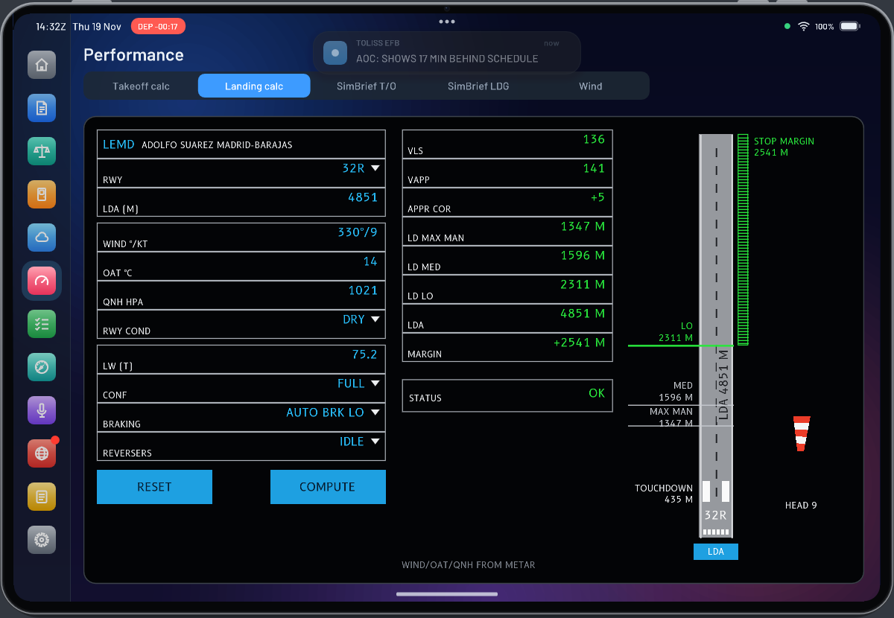 | 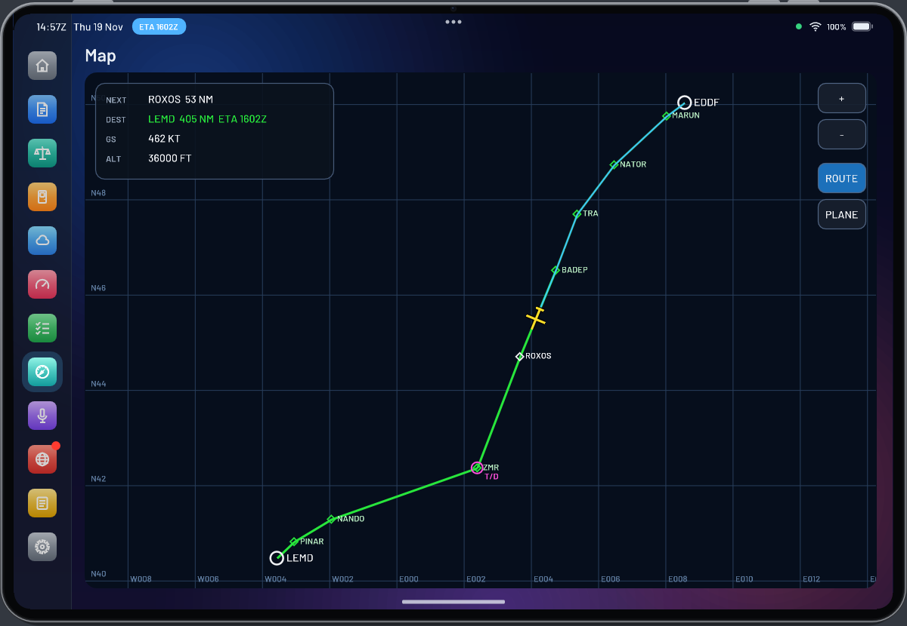 |
| **Map, zoomed in: airports, VORs, NDBs, airways** | **In flight: live ETA** |
| 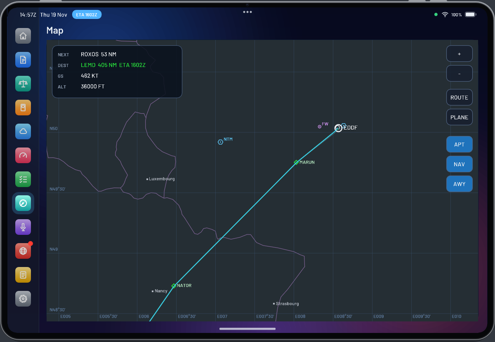 | 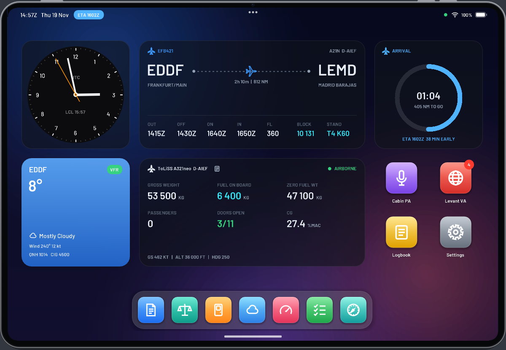 |
| **Logbook and landing rate** | |
| 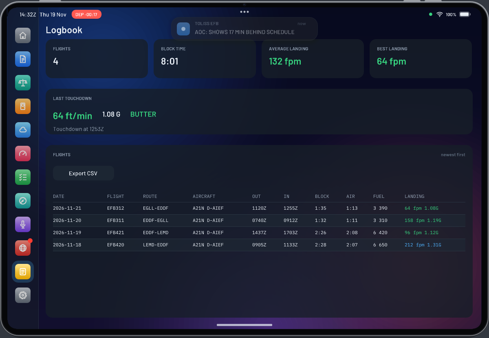 | |

## Apps

| App | What it does |
|---|---|
| **Home** | An iPadOS Home Screen. Widgets: analog UTC clock, today's flight (route, OUT/OFF/ON/IN, block fuel, arrival stand), departure countdown ring (after departure: the **live ETA** from where the aircraft is, distance to go and minutes early or late), weather and live aircraft weights, pax, doors and CG. Tap a widget to open its app. App icons sit beside the widgets, and the dock at the bottom holds your favourite apps plus the ones you used last. |
| **Flight Plan** | Fetches your latest **SimBrief** OFP. Has Summary, Navlog, Fuel breakdown (stacked bar), Weights vs. limits and the full OFP text. Every X-Plane start begins with no flight (the last one is deleted), unless you turn on *Settings > Keep the last flight when X-Plane starts*. |
| **Loadsheet** | Plan pax, forward and aft cargo and block fuel (from the OFP or by hand). Loads the aircraft **instantly** or **realistically**: boarding, cargo and refuelling run over time with progress bars, pause and stop. Shows planned vs. actual ZFW/TOW/LW against MZFW/MTOW/MLW, and prints a final loadsheet. |
| **Ground Ops** | Top-down aircraft diagram: tap a door to open or close it. Doors follow the aircraft's real door position, so a door opened from the ToLiSS ISCS shows as open, and doors swing on the diagram while moving. **Ground Power, Wheel Chocks, HP Air and LP Air** are found automatically on your aircraft. ToLiSS calls its own passenger stairs, catering trucks and belt loaders only from its ISCS (no other add-on can switch them), so the **ToLiSS vehicles** tab has an **Open the ISCS** button. **Customize** chooses which services are shown and which dataref each one uses. If a service doesn't respond, press **Learn** next to it and switch it in the aircraft: the tablet watches what changes and uses that. |
| **Weather** | METAR and TAF from aviationweather.gov, with quick chips for origin, destination, alternate and nearest. Decodes wind, visibility, ceiling, temperature and QNH, and shows a flight-category badge. |
| **Performance** | **Takeoff calculator** and **landing calculator** laid out like the ToLiSS ones (see below), plus the SimBrief takeoff/landing reports and a wind-component calculator. |
| **Checklists** | Tap-through normal checklists by phase, with progress and a "next item" highlight. |
| **Map** | An aviation chart: land and sea, coastlines, country borders, lakes and cities, plus X-Plane's own airports, VORs, NDBs and airways (they appear as you zoom in; APT / NAV / AWY switch them). On top: the SimBrief route with its waypoints and top of descent, the track you flew and your aircraft. Next waypoint, distance to go and ETA. Drag to move, + / - or the mouse wheel to zoom, ROUTE / PLANE to switch views. Zoom in on an airport, or press **ARPT**, for its **airport chart**: aprons and taxiways, runways with their numbers, taxiway names and the stands, read from X-Plane's own airport data. |
| **Logbook** | Every flight is logged by itself at ON BLOCKS: OUT/OFF/ON/IN, block and air time, fuel used and the **landing rate** (ft/min, G and a grade from BUTTER to HARD), which also pops up right after touchdown. Totals, average and best landing, and an Export CSV button. |
| **Airline** | AOC messages with your airline (see below) and the **Levant VA** website (https://levant-va.com/), opened in your web browser. The name and address can be changed. |
| **Settings** | SimBrief ID, kg/lb, passenger weight, cargo split, boarding/cargo/refuel rates, night/day theme, accent colour, **iPad finish** (Space Grey, Silver, Starlight, Blue), brightness and window behaviour. **Background:** gradient presets, three bundled wallpapers or **your own picture**. Press *Upload picture...* to open your computer's file picker, or paste a link to a JPG/PNG. Uploads are kept in `Output/preferences/toliss_efb_wallpapers`, so plugin updates don't delete them. There's also a dim slider. **Cockpit:** calibration of the 3D tablet. **Diagnostics:** dataref mapping (green = found, red = missing) and a live **Explorer** of every dataref. |

The window can sit inside the sim (drag it by the bezel, resize it from the edges),
**pop out** to its own OS window for a second monitor, or follow you into **VR**. The **•••** button
at the top of the screen opens the window menu (open in own window / return to the sim, hide),
just like iPadOS multitasking. It can
also go **onto the ToLiSS tablet in the 3D cockpit** (see below).

## What's new

See [CHANGELOG.md](CHANGELOG.md) for every version.

## On the 3D cockpit tablet

The EFB can replace the picture on the aircraft's own cockpit tablet. It draws into the
aircraft's panel texture, over the screen you calibrate, and you use it by clicking on the
3D tablet as usual.

**Fit it on the tablet (easiest):** *Settings → Cockpit → Fit on the tablet: drag the corners* (or *Plugins →
ToLiSS EFB → Fit cockpit tablet*). Orange handles appear on the 3D tablet: drag each corner (or an edge) to the edge
of the tablet's screen, drag the middle to move it, **ROTATE** if it's sideways, then **DONE**. The EFB fills that
area edge to edge. The first time on a new type, just click the middle of the screen and drag from there.

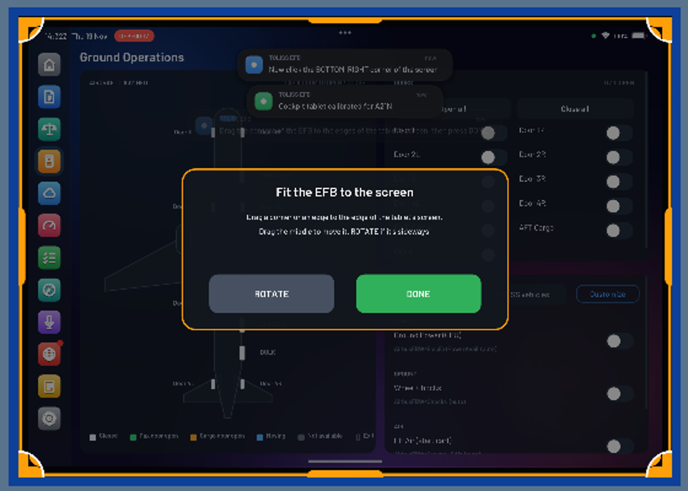

**On the tablet's AviTab page instead:** *Settings → Cockpit → Draw in the ToLiSS AviTab area* uses the area
ToLiSS reserves for AviTab (`AviTab.json` in the aircraft folder; built in when it's missing: A319/A320/A321 left
2119, bottom 9, A330-900/A340-600 left 142, bottom 16, both 1024 × 640). The EFB then shows only on the ToLiSS
tablet's AviTab page, not on its normal screen; turn AviTab off (*Plugins → AviTab → Enabled*). *Back to my
calibration* undoes it.

Or calibrate with a gesture:

1. Sit in the 3D cockpit, looking at the tablet so its whole screen is visible.
2. **Plugins → ToLiSS EFB → Auto-calibrate cockpit tablet...** (or *Settings → Cockpit → Auto calibrate*).
3. **Press and hold** the mouse on the tablet's screen and scribble back and forth **past all four
   edges**, then let go. The plugin fits the screen's position and rotation from that one gesture.
4. If the edges are a little off, nudge them in *Settings → Cockpit → Fine tune* (arrow keys to move; Narrower /
   Wider / Shorter / Taller resize around the centre, in steps down to half a texture pixel). The EFB fills the
   calibrated area corner to corner, so width and height each change exactly by the step. If auto
   calibration doesn't find the screen, the menu also has a manual mode: click the top-left
   corner, then the bottom-right one.

Calibration is saved per aircraft type (A319, A20N, A321, ...). **Plugins → ToLiSS EFB → Show on
cockpit tablet**, or the command `toliss_efb/cockpit_toggle`, switches between our EFB and the
original ToLiSS one. The × in the status bar does the same.

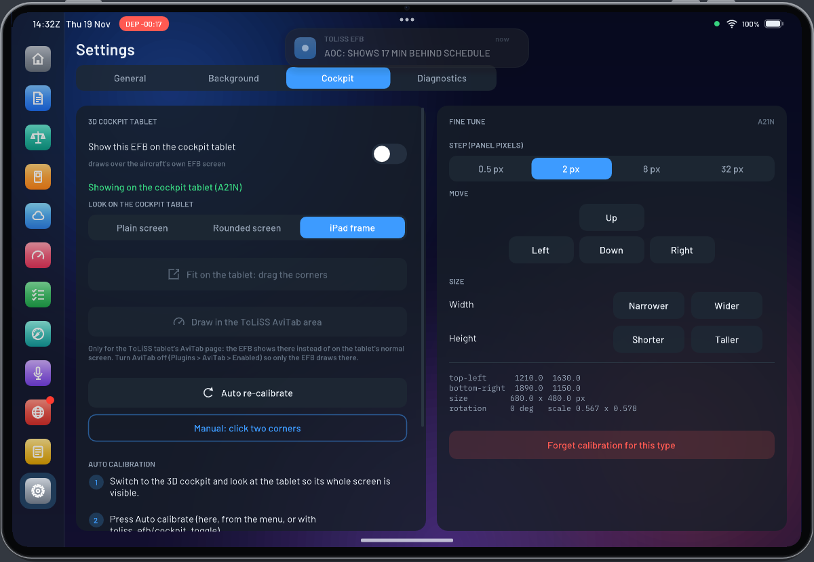

How it works: X-Plane tells plugins where the mouse ray hits the panel texture
(`sim/graphics/view/click_3d_x_pixels` / `_y_pixels`). A transparent, full-screen capture window
takes clicks that land on the calibrated screen and **passes every other click, and all
right-clicks (mouse look), straight back to the cockpit**.

Limitations:
* This only works if ToLiSS draws its tablet into the panel texture, which is how ToLiSS draws
  its cockpit screens. If nothing appears after calibrating, it doesn't, and the floating window
  is the way to go.
* The cockpit screen has only a few hundred texture pixels, so small print is soft. Headline
  values stay readable; zoom in (or use the floating window) for the fine print.
* In VR, the 3D-click datarefs don't follow the controllers, so use the floating window there.

## Install

**Easiest: SkunkCrafts Updater** (free, on the X-Plane.org forums). Install the plugin once
from the latest release zip (below). It contains `skunkcrafts_updater.cfg`, so SkunkCrafts Updater finds it in
`Resources/plugins/ToLiSS_EFB` and keeps it up to date. The tablet also tells you (Settings > About, and a badge on
the Settings icon) when a new version is waiting. Your settings, recordings, wallpapers and calibrations live in
`Output/preferences`, so updates never touch them.

Manual install:

1. Download the latest `ToLiSS_EFB_vX.Y.Z.zip` from the [**Releases** page](https://github.com/abdulkareem140/toliss-efb-releases/releases/latest) and unzip it into `X-Plane 12/Resources/plugins/`, so you get
   `Resources/plugins/ToLiSS_EFB/64/win.xpl` (Windows) or `lin.xpl` (Linux) plus the `resources/` folder.
2. Start X-Plane and load a ToLiSS aircraft.
3. Open it with **Plugins → ToLiSS EFB → Show / hide tablet**, or bind a key or joystick
   button to the command **`toliss_efb/toggle`** (`toliss_efb/popout` pops it out).
4. In **Settings**, enter your SimBrief username or numeric pilot ID and press *Fetch latest OFP*.

## Takeoff calculator

The real tool Airbus pilots use (FlySmart with Airbus / PEP) runs on Airbus's certified
performance database, which is licensed to airlines and not publicly available. This calculator
uses the same inputs and gives the same outputs, but computes them with a physics model:

* **Looks and works like the calculator in the ToLiSS tablet:** the same rows in the same order, labels
  low on the left and values high on the right in the Airbus cockpit font (B612), cyan inputs and green
  results, RESET and COMPUTE.
* **Inputs:** airport and runway from **X-Plane's own airport database** (`apt.dat`: real lengths
  and true headings), dry/wet, wind, OAT and QNH (filled in by themselves: the sim's own weather at the
  aircraft when you're at the airport, like the ToLiSS calculator, otherwise the METAR), takeoff weight
  and CG (they follow the aircraft while it's loaded, until you compute or type your own), flaps
  (AUTO / 1+F / 2 / 3), FLEX/TOGA, anti-ice and air conditioning.
* **Model:** integrates the ground run (thrust lapse with speed and temperature, aerodynamic drag,
  rolling friction, slope) for all engines and one engine out. From that it gets the takeoff
  distance (×1.15 for all engines; 35 ft screen, 15 ft wet), accelerate-stop with 2 s at V1, the
  balanced V1 and the one-engine-out second-segment climb (2.4 % twin / 3.0 % quad). Wind is
  factored 50 % headwind / 150 % tailwind. V2 = 1.13 VS1g, with VMCG/VMCA limits.
* **Outputs:** CONF (AUTO picks the flap setting that allows the most FLEX), the highest legal
  **FLEX** (max 25 % thrust reduction), the **V1 range** (lowest to highest legal V1), VR, V2, THS for
  the CG, GREEN DOT and RTOW. The runway picture shows the accelerate-stop distance at the lowest and
  highest V1, the runway left over after each stop (STOP MARGIN), the windsock and the crosswind. If no
  takeoff is legal, it says why and gives the maximum TOW.

The A320 numbers are matched to the ToLiSS calculator: for the same airport, weight and weather
(OEGN runway 15, 60.2 t, 32 °C, 227°/11 kt) both give CONF 1+F, FLEX 68, V1 114-138, VR 138, V2 140,
THS UP0.7 and GREEN DOT 205. They are still **estimates, not certified data**.
Always compare them with the ToLiSS MCDU PERF TAKE OFF page.

## Landing calculator

Performance > **Landing calc** works the same way for the arrival: the destination and its runways come from
X-Plane's airport data (the plan's runway is picked first), the landing distance available (LDA) is the runway
minus any displaced threshold, and the landing weight follows the flight (what's left after the fuel still to
burn on the plan) until you type your own.

* **VLS** is 1.23 × the 1-g stall speed in CONF FULL or 3; **VAPP** adds a third of the headwind (5 to 15 kt).
* **Landing distance** from 50 ft over the threshold: the air distance to touchdown, 2 s to get the spoilers out
  and the brakes on, then braking at the autobrake rate (LO 1.7, MED 3 m/s²) or the most the runway allows
  (MAX MANUAL), with the reversers' help. Wind is factored 50 % headwind / 150 % tailwind, and the result × 1.15.
* The runway picture shows the touchdown point and where you stop with each braking mode, and the runway left over.

These are **estimates, not certified data**. Compare them with the ToLiSS MCDU and your own judgement.

## ⚠️ First flight: verify the datarefs

The tablet talks to the aircraft only through the names in
`ToLiSS_EFB/resources/datarefs.ini`:

* **Loading** uses `AirbusFBW/NoPax`, `PaxDistrib`, `FwdCargo`, `AftCargo`, `WriteFOB`
  and the command `AirbusFBW/SetWeightAndCG`. These are the names community SimBrief-loader
  scripts use for ToLiSS.
* **Doors** use `AirbusFBW/PaxDoorModeArray[i]` / `CargoDoorModeArray[i]`
  (0 = closed, 2 = open). **The index order differs between types.** Check it.
* **Ground services** (GPU, chocks, HP/LP air) and **door positions** are **found automatically**.
  X-Plane 12 lets plugins list every dataref, and the plugin ranks ToLiSS's by name, preferring
  writable values over cockpit buttons, lights and animations. *Ground Ops → Customize* shows the
  choice for each service and lets you pick another. *Settings → Diagnostics → Explorer* shows
  every dataref live: toggle something in the aircraft and watch which value changes.

Open **Settings → Diagnostics** with the aircraft loaded. Red rows don't exist in your
aircraft. Fix them in the INI and press *Reload*. No recompiling is needed. You can add
per-type sections such as `[doors.A21N]` or `[limits.A339]`.

## What this is and isn't

* Weights shown as "planned" are estimates. The "aircraft" column is what X-Plane reports.
  Always cross-check V-speeds and FLEX against the MCDU PERF pages.
* Checklists are simplified and for simulation only.
* Not affiliated with ToLiSS, Fenix Simulations, SimBrief/Navigraph or Laminar Research.

## Report a bug

On the tablet: **Settings > About > Report a bug...** It opens a pre-filled issue here, with the version, X-Plane,
aircraft and the plugin's recent log (your folder names removed). You can also
[open an issue](https://github.com/abdulkareem140/toliss-efb-releases/issues/new/choose) yourself.

## Licences

ToLiSS EFB: © 2026 Abdulkareem Samman (see `LICENSE`). It includes Dear ImGui (MIT), nlohmann/json (MIT), and the
Barlow, IBM Plex Mono and B612 fonts (SIL Open Font License 1.1). Map base layer: Natural Earth (public domain).
